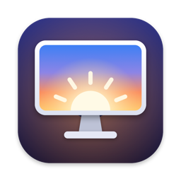
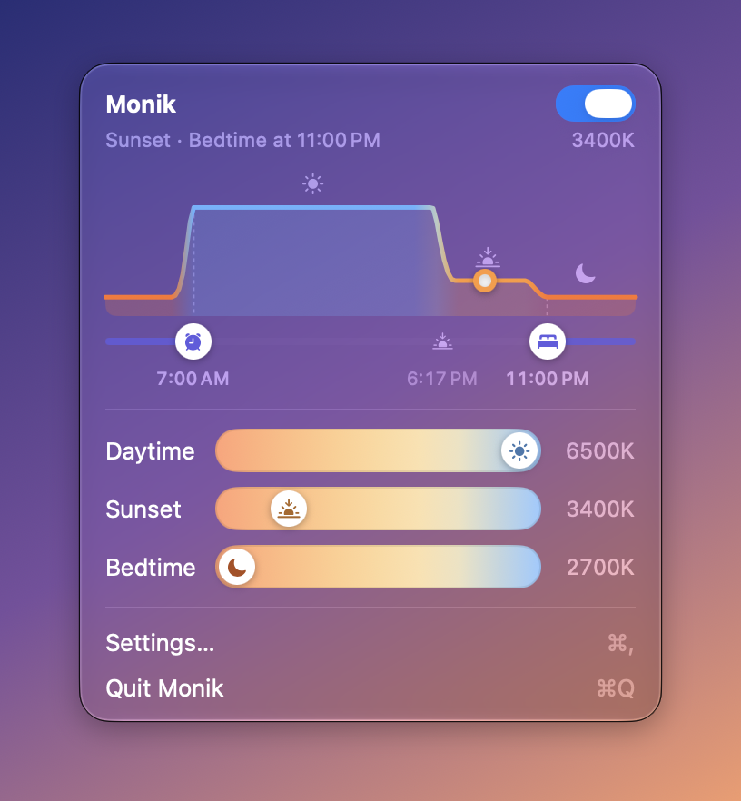

<p align="center"></p>

# Monik

Monik is a free, open source menu bar app for macOS that warms the color temperature of your monitors as the day ends, in the spirit of f.lux and Night Shift. It follows the sun where you are and your own bedtime.

<p align="center"></p>

## What it does

- **Three colors, one smooth curve.** Pick a color temperature for daytime, sunset and bedtime, anywhere from 2700K to 6500K. Monik fades between them around sunrise and sunset at your location, and again as your bedtime approaches.
- **Your day on a chart.** The dropdown draws the next 24 hours around your own wake time and bedtime. Drag the alarm and bed knobs to change them; drag a color bar and the screen previews it.
- **Every display.** All connected monitors get the same color, and keep it across Spaces, sleep and display changes.
- **Out of the way when color matters.** Monik pauses while a full-screen app is in front, and while any app you list (a photo editor, a video player) is in front.
- **One switch.** Turn it off and on from the dropdown.
- **Private.** Your location is read once, when you press the location button, or not at all if you type a city instead. There is no analytics and no network use beyond Apple's place lookup.

## Requirements

macOS 15 or later. So far Monik has only been run on macOS 27.

## Install

There is no prebuilt download yet, so build it from source. You need Xcode and [XcodeGen](https://github.com/yonaskolb/XcodeGen).

```sh
brew install xcodegen
git clone https://github.com/Astatine-213-Tian/monik.git
cd monik
xcodegen generate
xcodebuild -project Monik.xcodeproj -scheme Monik -configuration Release -derivedDataPath build build
ditto build/Build/Products/Release/Monik.app /Applications/Monik.app
open /Applications/Monik.app
```

Quit f.lux and turn off Night Shift first: two apps changing the screen color at once fight each other. Monik warns you in its dropdown if f.lux is running.

## How it works

- **Color.** Monik turns a color temperature into red, green and blue gains from the black-body curve and writes them into each display's gamma table (`CGSetDisplayTransferByTable`). At 6500K it writes nothing, and macOS restores the tables when Monik quits.
- **Schedule.** Sunrise and sunset are worked out on your Mac from your coordinates. The curve is `mix(mix(sunset, day, daylight), bedtime, sleep)`, eased and blended in mired so the change looks even.
- **Private macOS interfaces.** Two are used, each looked up at run time and skipped if missing: the window server's list of Spaces, to tell when a full-screen app is in front, and the status item's presentation session, to close the dropdown when Settings opens.

## Development

- `project.yml` is the source of truth for the Xcode project. Run `xcodegen generate` after adding or moving files.
- Run the tests with `xcodebuild -project Monik.xcodeproj -scheme Monik -derivedDataPath build test`.
- Debug builds include a small remote control (`Monik/Debug`) that can open the real dropdown and click or drag in it from a script, which is how the interface is tested without Accessibility permission.

## Known limits

- Multiple displays are handled in code but have so far been tested with only a built-in display connected. Reports are welcome.
- Launch at login has not been tested yet.
- The app is not notarized, which is why there is no download.

## License

[MIT](LICENSE). Monik is not affiliated with f.lux.
